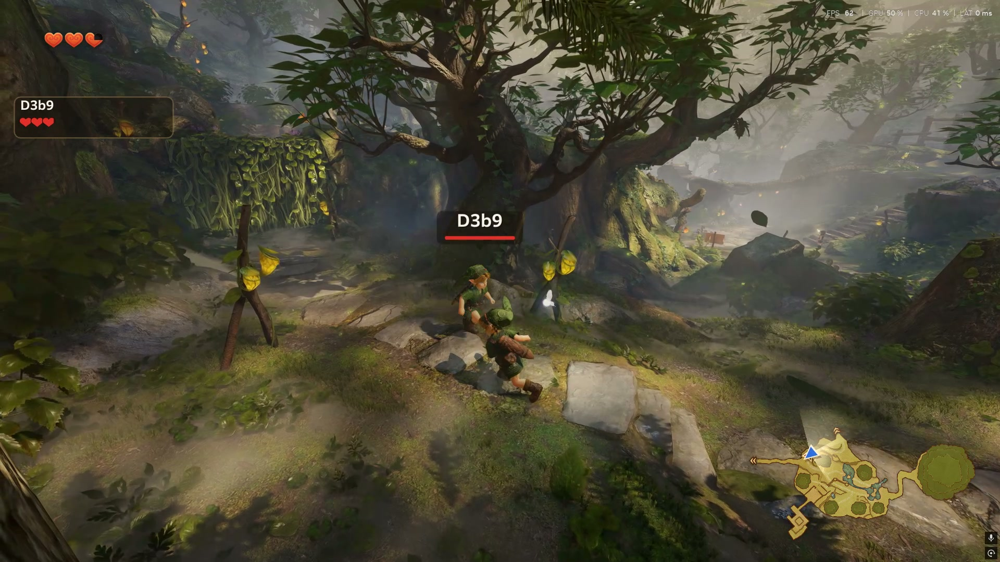
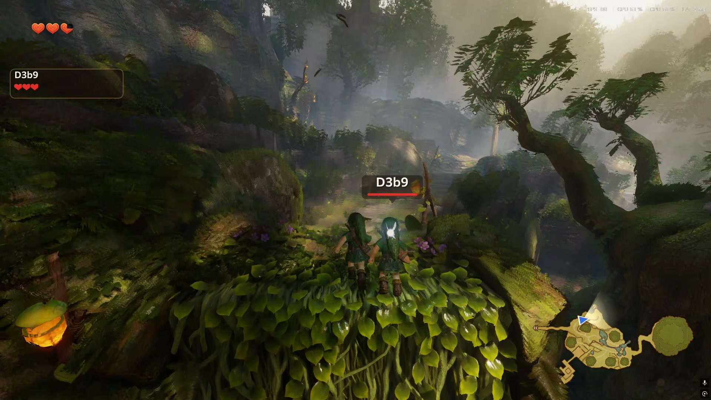
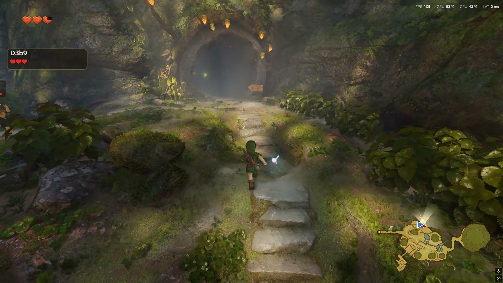

# Zelda Co-op (PC Multiplayer Mod)

**Lead Developer & Project Owner:** [Osama-Alzahrani-UQU](https://github.com/Osama-Alzahrani-UQU)  
**Project Status:** Tested & 100% Working (Debug Confirmed)  
**Support & Donations:** [paypal.me/onlinerp53](https://paypal.me/onlinerp53)

An online multiplayer cooperative mod for the Longshot PC game engine. Allows 2 to 4 players over **Radmin VPN** (or local LAN) to explore, adventure, and battle together in real time. One player hosts a game directly from their save file, and friends connect to join the exact same world session.

---

## Important Notice & Requirements

> [!WARNING]
> ### 1. Launcher Compatibility (Longshot Launcher ONLY)
> **This multiplayer mod works EXCLUSIVELY on the Longshot Launcher (`longshot.exe`).**  
> It does **NOT** run on standalone emulators (such as RetroArch, Project64, etc.) or vanilla ROMs. You must install and launch the mod through your Longshot installation folder containing `longshot.exe`.
>
> ### 2. Save File Location Synchronization (Crucial)
> **All participating players MUST save their game at the exact same location** (for example: *Kokiri Forest* or *Link's House*) before connecting. This ensures everyone spawns together in the same zone without spatial desynchronization.
>
> ### 3. Radmin VPN Connection (Mandatory for Smooth Play)
> **All players MUST install Radmin VPN and join the EXACT same virtual network room.**  
> Online lobbies, host discovery, and real-time synchronization depend on players sharing the same Radmin VPN network. Joining different networks or playing without Radmin VPN will result in connection errors and rooms failing to appear.
>
> ### 4. Beta Release Notice
> This mod is currently in active **Beta**. The developer ([Osama-Alzahrani-UQU](https://github.com/Osama-Alzahrani-UQU)) is fully aware that there are known bugs, edge cases, and visual glitches. Regular updates and fixes are continuously being developed. Feedback and bug reports are welcome!

---

## Media & Showcase

### Video Showcase (TikTok)
Watch the official co-op gameplay montage on TikTok:  
🎬 **[Watch Gameplay on TikTok](https://vt.tiktok.com/ZSpGeU23w/)**

### In-Game Screenshots

| Co-op Duo Exploration | Partner Wall Climb |
| :---: | :---: |
|  |  |

| Exploration Path | Co-op Dialogue & Interaction |
| :---: | :---: |
|  |  |

---

## Installation Guide (For Each Player)

1. **Close the game:** Ensure `longshot.exe` is completely closed.
2. **Run Installer:** Launch `LongshotCoop-Setup.exe`.
3. **Select Folder:** Ensure the folder containing `longshot.exe` is selected. If not detected automatically, click **Browse...** and select it.
4. **Click Install:** Click **Install** to apply the mod cleanly into the game.
5. **Radmin VPN Setup (Essential):**
   - Download and install [Radmin VPN](https://www.radmin-vpn.com/).
   - One player creates a room: Click **Network > Create new network** (set a network name & password).
   - All other players join: Click **Network > Join an existing network** and enter the same credentials.
   - Confirm all players show up with green active indicators in the same Radmin network.
6. **Launch & Enjoy:** Start the game from `longshot.exe`. You will see the new **Online** option on the title screen!

*To uninstall: Simply run `LongshotCoop-Setup.exe` again and click **Uninstall**. The game's original files remain completely intact.*

---

## How to Play

- **Access Online Menu:** On the title screen, click the new **Online** entry below the main menu.
- **Set Player Name:** On your first launch, enter your preferred player display name.
- **Hosting a Game:**
  1. Click **Host Game**.
  2. Select your save file on the game's Load screen.
  3. The server starts and the lobby opens (supports up to 4 players).
  4. Other players on the same Radmin network will automatically see your room in their **Join Game** list.
  5. Click **Start Game** once everyone is ready to spawn into Hyrule together.
- **Joining a Game:**
  1. Click **Join Game**.
  2. Select the host's room from the lobby list (or choose **Join by Address** and enter the host's Radmin VPN IP).
  3. Select your save file (matching the host's save location) and press **Ready**.
- **In-Game Overlay:**
  - Press **F2** on keyboard (or **L3 + R3** on controller) at any time to open the in-game co-op menu to manage connected players, adjust networking settings, or trade items via **Give To...**.

---

## Support & Donations

If you enjoy this multiplayer mod and want to support ongoing updates, server optimizations, and new features:

👉 **Donate via PayPal:** [paypal.me/onlinerp53](https://paypal.me/onlinerp53)

---

## License & Intellectual Property

Copyright (C) 2026 **Osama-Alzahrani-UQU**. All rights reserved.  
Project repository: [https://github.com/Osama-Alzahrani-UQU/zelda-coop](https://github.com/Osama-Alzahrani-UQU/zelda-coop)
