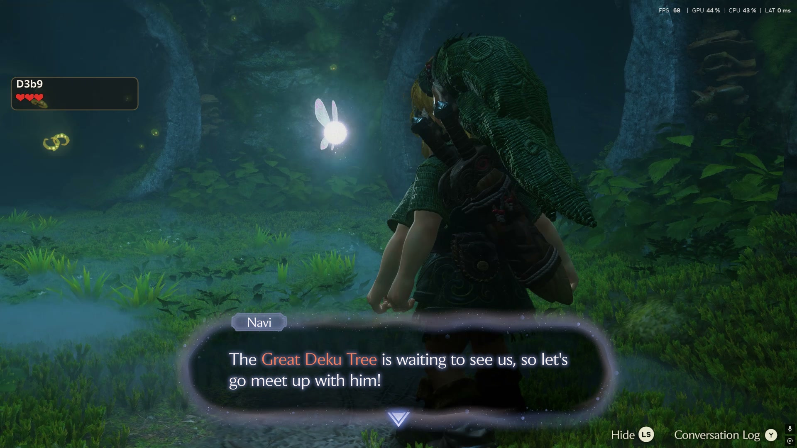

# Zelda Co-op (Longshot Co-op): Online Multiplayer Mod

**Created, designed and maintained by:** [Osama-Alzahrani-UQU](https://github.com/Osama-Alzahrani-UQU)  
**Version:** 1.1.2 (Public Beta)  
**Repository:** [github.com/Osama-Alzahrani-UQU/zelda-coop](https://github.com/Osama-Alzahrani-UQU/zelda-coop)  
**Support & Donations:** [paypal.me/onlinerp53](https://paypal.me/onlinerp53)

Longshot Co-op is an online co-op mod for *The Legend of Zelda: Ocarina of Time* on the **Longshot** PC build. Two to
four players play together over **Radmin VPN** (or a local network): the host's save is the shared world, friends drop
straight into it, and enemies, the world and items are shared between everyone's game in real time.

> Copyright (C) 2026 **Osama-Alzahrani-UQU**. All rights reserved. See [LICENSE.md](LICENSE.md).  
> Unofficial fan project, not affiliated with or endorsed by Nintendo. No game files are included.

---

## Important Notice & Requirements

> [!WARNING]
> ### 1. Longshot only
> The mod works **only** with the Longshot PC build started from `longshot.exe` (Longshot v3.0.0-rc.3). It does not run
> on emulators (RetroArch, Project64, ...) or other ports.
>
> ### 2. Radmin VPN (or the same local network)
> **All players must install [Radmin VPN](https://www.radmin-vpn.com/) and join the same network.** Games are found,
> and players connect, through that network. Different networks, or no network, mean the server does not show up.
>
> ### 3. The same mod version on every PC
> Every player needs the same version of Longshot Co-op. A host refuses a friend on another version with a clear
> message (install the same Setup on both PCs).
>
> ### 4. Beta
> This is a public **Beta**. The developer ([Osama-Alzahrani-UQU](https://github.com/Osama-Alzahrani-UQU)) knows there
> are rough edges and keeps improving the mod. Bug reports and feedback are welcome in the repository's Issues.

---

## Media & Showcase

### Video Showcase (TikTok)
Watch the co-op gameplay montage on TikTok:  
🎬 **[Watch Gameplay on TikTok](https://vt.tiktok.com/ZSpGeU23w/)**

### In-Game Screenshots

| Co-op Duo Exploration | Partner Wall Climb |
| :---: | :---: |
|  |  |

| Exploration Path | Co-op Dialogue & Interaction |
| :---: | :---: |
|  |  |

---

## Features

### Hosting and joining
- **Host Game** offers **Continue** (your newest save), **New Game** and **Choose a File**. The game starts at once and
  friends can join while you play: there is no waiting lobby.
- **Join Game** lists the servers on your Radmin VPN network (or **Join by Address**). A guest never picks a file: the
  host's save is sent over the network (about a second) and the guest's game loads it. Everyone plays in the **host's
  world**.
- **Each player keeps their own things.** A guest's items, rupees and bags are kept by the host under the guest's name
  and given back every time they join again.
- **Your own saves are safe.** While a guest plays in the host's world, the guest's own saves are copied aside and put
  back when they leave the session (back at the title, at the next start after a crash, or when the mod is
  uninstalled).
- With **New Game**, the host answers the game's own "Previous autosave data will be overwritten" question; guests start
  the new game with the host automatically (their saves set aside first).

### Shared enemies
- An enemy near several players is run by the game of the nearest player and copied, pose by pose, in the others'
  games: its moves, attacks and reactions are the same for everyone.
- **Every player sees the enemy's attacks**: the animation it plays in the game running it (attacks, jumps, reactions,
  falls) is played on it in every game, with the game's own effects and sounds for those animations. (Shots an enemy
  fires, such as an Octorok's rock, are still seen only by the player they are fired at.)
- **Hits are shared as real blows**: a hit in one game is given to the same enemy in the others through the game's own
  damage, so it flinches and reacts there too.
- **Kills are shared as real deaths**: the enemy plays its own death in every game and **drops its own loot** for each
  player (Deku Nuts, rupees, hearts...).
- **Every kind of enemy is shared**, including the ones the game keeps their life in another way (Bari and Biri
  jellyfish, Shabom bubbles, Tektites, Wallmasters, the Lost Woods stage Scrubs), and enemies made during play (the
  Biri a Bari splits into, respawning bubbles) are paired too.
- **Every enemy near another player stays in step**, however full the room: the nearest every moment, the rest in turn,
  each one refreshed several times a second.
- The same enemy is recognised in every game by where the map placed it, so each one is paired exactly; no extra
  enemies are ever made (an enemy in a room another player has loaded and you have not is simply not there for you).
- When two games would both run the same enemy at once, one of them always gives way, so an enemy is never left to
  nobody or flickering between players.
- **Bosses** run in each game on their own (so they never get pushed into walls); their hits and their defeat are
  shared.
- **The other players' shots are drawn where they fly**: slingshot seeds, Deku Nuts, arrows and the hookshot's chain,
  with their end as their own burst (a Deku Nut's white flash, a seed's or an arrow's spark). What they hit is shared.

### Shared world
- **Live**: cutting grass, breaking pots, striking eye switches and burning webs happen in every game at once, each
  with its own effect and drop (the rupee in the grass is there for everyone).
- **Lasting state**: doors unlocked, switches pressed, webs broken, blocks and platforms moved are shared through the
  game's own object flags.
- **Doors open in front of you**: a door another player opens or closes near them swings open and shut in your world
  with its own animation.
- **Gone at once**: a web, a rock, a cracked wall or a lock another player breaks or opens disappears in your world right
  away, even while you look at it. Other objects (ladders, platforms) take their new state when their room is entered
  again.
- **Bombs go off in every world**: a player's bomb explodes at the same spot in the others' games with its real blast
  (cracked walls, rocks, enemies, anyone too close); its hits are counted once.
- **Chests are each player's own**: everyone opens their own chest and gets its item. When a friend opens a chest in the
  room you are in, you are told that yours still holds its item for you.

### Playing together
- The other players appear as Link with their real pose, sword, shield and items in hand, nameplates and hearts.
- **Give To** (pause menu, A on an item; or the online panel): give items, consumables and **rupees** to another
  player. Quick: item, amount, player (chosen for you when there is only one).
- **Revive**: a player who falls waits for a friend (hold A beside them) or gives up (hold -) and returns to the area's
  entrance with all their items.
- **The pause menu does not stop the world** while you play together (Link waits, the world goes on).
- Area map and world map markers for the other players.
- Starting gear and bags for new players, so gifts and pick-ups always work.
- Auto-save every 3 minutes while online.

### Co-op Frame Generation
A new mod option in **Online Settings**:

> **Note:** made for NVIDIA cards (RTX 20 and RTX 30 series too, where DLSS Frame Generation is not available).

It runs the renderer's own frame generation at **2x**, with **frame pacing**, each frame presented on **a thread and queue
of its own**, and **one frame queued ahead instead of two** (one frame less of input delay). It can only be turned on
while the game's own **Frame generation** option is **Off**, so the two never run together, and it takes effect the
next time the game starts.

---

## Installation Guide (For Each Player)

1. **Close the game** (`longshot.exe`).
2. **Run** `LongshotCoop-Setup.exe`.
3. **Select the game folder** (the one containing `longshot.exe`). It is usually found automatically; otherwise click
   **Browse...**.
4. Click **Install**. Only `bin\winmm.dll` (the loader) and `bin\coop\LongshotCoop.dll` are added; the game's own
   files are never changed.
5. **Radmin VPN:**
   - Install [Radmin VPN](https://www.radmin-vpn.com/).
   - One player: **Network > Create new network** (name and password).
   - Everyone else: **Network > Join an existing network** with the same name and password.
6. Start the game from `longshot.exe`: the title screen has a new **Online** entry.

**Uninstall:** run the Setup again and click **Uninstall** (tick the box to also remove the mod's settings and logs).
Saves the mod set aside are put back first.

**Command line (scripts):**
```
LongshotCoop-Setup.exe -silent -install "<game folder>"
LongshotCoop-Setup.exe -silent -uninstall "<game folder>" [-removesettings]
```
Exit codes: 0 done, 1 bad arguments, 2 not a Longshot game folder, 3 the game is running, 4 a file could not be written.

---

## How to Play

- **Online menu:** on the title screen, choose **Online**. The first time, type the name the others will see.
- **Host:** **Host Game** > **Continue**, **New Game** or **Choose a File**. Friends on your Radmin network see your server
  in **Join Game**.
- **Join:** **Join Game** > the host's server (or **Join by Address** with the host's Radmin VPN address, for example
  `26.12.34.56`). You arrive in the host's world beside the host.
- **In-game panel:** **L3 + R3** on a controller (or **F2** on the keyboard): the players, **Give To...** and **Online
  Settings**.
- **Give an item:** in the pause menu, press **A** on an item > **Give To**, choose how many, done.

### Online Settings
| Setting | What it does |
| :--- | :--- |
| Server name, Players, Password, Port | The server you host. |
| Join while playing | Friends may join a game in progress (always on when you host from Host Game). |
| Shared kills | Enemies and bosses defeated in one game are defeated in every game. |
| Gifts | Players may give each other items. |
| Same age as the host | Guests play Link at the host's age. |
| Bring guests to the host | Guests appear beside the host when they arrive. |
| Revive fallen players | A fallen player can be revived by a friend. |
| Enemies return when a player joins | Defeated enemies come back for everyone when someone new joins. |
| Starting gear for new players | New players get the host's first weapons and bags. |
| Nameplates, Players list, sizes | What you see of the other players. |
| Ask before gifts | Ask before taking a gift (off: gifts are taken at once). |
| Motion smoothing | How the other players' movement is smoothed. |
| Auto-save | Your game saves every 3 minutes while online. |
| **Co-op Frame Generation** | See above. |

---

## Troubleshooting

| Problem | What to do |
| :--- | :--- |
| The server does not appear | Both players in the same Radmin VPN network (green dots)? Try **Join by Address**. Allow `longshot.exe` in the Windows firewall. |
| "Different mod versions" | Install the same `LongshotCoop-Setup.exe` on every PC. |
| "The host's world did not arrive" | The connection dropped while the save was sent: join again. |
| My own saves | They are put back automatically when you leave the session, at the next start, or on Uninstall. They are kept in `bin\coop\save_backup` until then. |
| Co-op Frame Generation shows "Unavailable" | Turn the game's own **Frame generation** option **Off** first, then restart the game. |
| Logs | `bin\coop\coop_log.txt` (attach it to bug reports). |

---

## Building from source

Requirements: the llvm-mingw toolchain that comes with Longshot's builder (found automatically under
`LongshotLauncher-data\toolchains`), Python 3 (for the Setup icon).

```
powershell -ExecutionPolicy Bypass -File build.ps1 [-Install "<game folder>"]
powershell -ExecutionPolicy Bypass -File installer\build_setup.ps1
```
Outputs: `build\winmm.dll`, `build\coop\LongshotCoop.dll`, `build\LongshotCoop-Setup.exe`.

Source layout (`src/coop`): `session` (network and lobby), `coopsave` (the host's world for guests, saves set aside,
items kept), `menus`/`title`/`dialogs`/`overlay` (menus and HUD), `game` (the game's state, gifts, saves), `enemies` and
`fellow` (shared enemies, kills, revive), `world` (shared world objects), `pose`/`puppet` (the other players' Links),
`framegen` (Co-op Frame Generation), `runtime` (hooks into the Longshot runtime).

See [CHANGELOG.md](CHANGELOG.md) for what changed in each version.

---

## Support & Donations

If you enjoy the mod and want to support updates and new features:

👉 **Donate via PayPal:** [paypal.me/onlinerp53](https://paypal.me/onlinerp53)

---

## Credits, License & Intellectual Property

- **Author, design and development:** [Osama-Alzahrani-UQU](https://github.com/Osama-Alzahrani-UQU)
- Copyright (C) 2026 **Osama-Alzahrani-UQU**. All rights reserved. Use is governed by [LICENSE.md](LICENSE.md).
- *The Legend of Zelda* is a trademark of Nintendo. This is an unofficial fan project, not affiliated with or endorsed
  by Nintendo. You need your own legally obtained copy of the game; the mod contains no game data.
- Third-party code: [Dear ImGui](https://github.com/ocornut/imgui) and [MinHook](https://github.com/TsudaKageyu/minhook),
  each under its own license (see `third_party/`).
